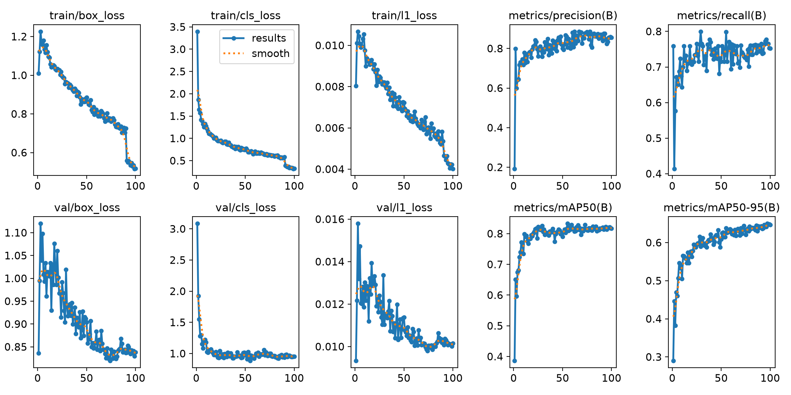

# Bird Detector

Донавчання YOLO26n від Ultralytics для детекції одного класу (птахів) на відео та фотографіях. 

У репозиторії є скрипти для: підготовки даних, процесу навчання та обробки відео. Також є найкращі ваги дотренованої моделі, приклади оброблених відео трьох рівнів складності та файл з потрібними утилітами.

## Структура проєкту

```
├── README.md
├── requirements.txt
├── train.py #донавчання та порівняння з претренованою моделлю 
├── predict_video.py #обробка відео донавчаної моделі
├── scripts/
│   └── prepare_dataset.py #чистка розмітки та поділ train/val
├── weights/
│   ├── best.pt #найкращі ваги моделі
│   └── best_conf.txt #найкращий поріг confidence для моделі
└── examples/ 
    ├── results.png #графіки процесу навчання
    ├── easy/   input.mp4, output.mp4 #легкий приклад
    ├── medium/ input.mp4, output.mp4 #середній приклад
    └── hard/   input.mp4, output.mp4 #важкий приклад
```

## Запуск

Потрібен Python 3.12 або 3.13. Усі команди виконуються з кореня репозиторію.

```bash
git clone https://github.com/dpushkaruk/Bird_Detector_Test
cd Bird_Detector_Test
python -m venv .venv
```

На macOS і Linux замість `python` зазвичай використовується `python3`.

Активація середовища: 

`.venv\Scripts\activate` (Windows) 

`source .venv/bin/activate` (macOS, Linux).

Встановлення залежностей:

```bash
# Windows, CPU / macOS (Apple Silicon, macOS 14+), CPU
pip install -r requirements.txt

# Linux, CPU 
pip install torch==2.14.0 torchvision==0.29.0 --index-url https://download.pytorch.org/whl/cpu
pip install -r requirements.txt

# NVIDIA GPU (Windows і Linux)
pip install torch==2.14.0 torchvision==0.29.0 --index-url https://download.pytorch.org/whl/cu126
pip install -r requirements.txt
```

Обробка відео:
щоб самостійно обробити приклади відео трьох рівнів, запустіть кожну з наданих команд окремо:

```bash
python predict_video.py --input examples/easy/input.mp4 --output examples/easy/output.mp4
python predict_video.py --input examples/medium/input.mp4 --output examples/medium/output.mp4
python predict_video.py --input examples/hard/input.mp4 --output examples/hard/output.mp4
```

Навчання з нуля: 
завантажити архів датасету з Kaggle і розпакувати його в папку `dataset/` у корені репозиторію, щоб вийшло `dataset/bird/*.jpg` і `dataset/bird/labels/*.txt`, потім в терміналі запустити команди:

```bash
python scripts/prepare_dataset.py
python train.py
```

## Датасет

https://www.kaggle.com/datasets/samuelayman/bird-dataset, датасет з kaggle, ліцензія Apache 2.0. 950 зображень птахів з розміткою у форматі YOLO.

Розмітка вже була у форматі YOLO, але `class_id` у всіх файлах дорівнював `24`.

Скрипт `scripts/prepare_dataset.py`:
- переводить усі класи в `0` (`bird`);
- відкидає биті рядки та бокси, що виходять за межі зображення;
- ділить дані на train/val у пропорції 80/20 з фіксованим seed (`42`), тому спліт однаковий на будь-якому пристрої;
- щоразу перестворює `data/bird/` з нуля, щоб train і val не перетиналися після повторних запусків;
- генерує конфіг `data/bird/data.yaml` для Ultralytics.

Результат: **760** зображень у train, **190** у val (418 птахів у val).

## Навчання

`yolo26n.pt`, 100 епох (`patience=20`), `freeze=10`, `imgsz=640`, `batch=16`, `workers=2`, `seed=42`. Оптимізатор, лос і аугментації використав стандартні від Ultralytics.
Заморожений backbone і рання зупинка обрані через невеликий датасет й невелику, проте добре претреновану модель.

Навчання на NVIDIA GTX 1660 SUPER вийшло приблизно 21 хв на 100 епох.

## Метрики на validation

| модель | mAP50 | mAP50-95 | Precision | Recall | best conf |
|---|---|---|---|---|---|
| pretrained YOLO26n | 0.636 | 0.535 | 0.598 | 0.761 | 0.26 |
| **finetuned** (`freeze=10`) | **0.819** | **0.649** | **0.831** | **0.770** | **0.33** |

Recall майже не змінився, бо pretrained модель уже знала клас `bird` з COCO. Основний приріст дала precision: донавчена модель значно рідше дає хибні бокси.
Pretrained модель валідувалась з `single_cls=True`, щоб її 80 класів COCO можна було порівняти з одним класом розмітки.
`best conf` це поріг з максимальним F1 на val, саме його використовує інференс `predict_video.py`.

### Графіки тренувальних і валідаційних метрик


## Проблеми та можливі покращення

**Проблеми:**
- На CPU навчання займало ~6 хв на епоху, тому модель навчалась на GPU.
- З дефолтними `workers` на Windows закінчувалась оперативна пам'ять, тому вказав `workers=2`.
- Для torch 2.15 немає CUDA 12.6 збірок, тому версії зафіксовані на `torch 2.14.0`.

**Покращення:**
- Більше даних, зокрема дрібні птахи на далекому плані і загалом більш важкі семпли.
- Більший `imgsz` (960–1280) для дрібних об'єктів.
- Порівняння з `freeze=0` і більше навчання, адже mAP50-95 ще ріс на 100-й епосі.
- Фонові кадри без птахів, щоб зменшити хибні бокси на відео.
- Окрема test-вибірка для чесної фінальної оцінки.
- Підбір гіперпараметрів (lr, аугментації, ваги лосу) на окремій test-вибірці.
- Експерименти з різними параметрами моделі.
- Трекінг між кадрами, щоб бокси на відео не миготіли.
